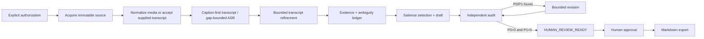
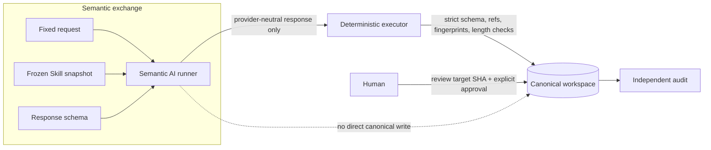

# Video Evidence Pipeline

認可済みの動画・音声・文字起こしを、根拠と監査結果が結び付いた成果物へ変換する、local-firstの証拠パイプラインです。

VEPの出力は「AIが書いた文章」だけではありません。source、transcript、evidence、要件、監査、承認の関係を保存したprivate workspaceから、human reviewへ渡せるMarkdownを生成します。

## What can I do?

- 認可済みのlocal／network sourceを取得し、raw sourceをimmutableに保つ
- video、audio、supplied transcriptからraw transcriptを作る
- captionを優先し、不足区間だけをboundedなASRへ渡す
- timestamp・frame・supporting inputに結び付いたatomic evidenceとambiguity ledgerを作る
- purpose／audience／requirementsに合わせてsummary、report、meeting-style outputを作る
- authorとは別のfresh contextで監査し、findingに限定したrevisionを最大2回行う
- 人間がreview packageを確認し、明示的にapprovalしたMarkdownをexportする

## Inputs, outputs, and boundaries

### Inputs

| 種類 | 例 | 契約 |
| --- | --- | --- |
| Primary input | `video`、`audio`、`transcript` | 1ジョブにつき1つ。supplied transcriptならmedia decodeを省略できる |
| Supporting input | local `pdf`、`image`、`notes` | assignmentの根拠として明示されたものだけ |
| Assignment | task type、language、requirements、`--purpose`、`--audience`、length | semantic selectionのsource。promptだけを正本にしない |
| Authorization | local processing、network acquisition、external APIの明示許可 | 未確認の権限やcredentialを推測しない |

### Outputs

- immutable source／media／transcript manifests
- source refsに結び付いたevidence、ambiguity、private search cache
- draft、独立audit、bounded revision、human-review package
- 人間承認後のbyte-exact Markdown export

VEPは実データをGitへ追加しません。workspaceはprivate local stateであり、Cookie、token、署名付きURL、実動画、音声、字幕、transcript、evidence response、ユーザー成果物をcommitしないでください。

### Non-goals and unsupported boundaries

- 利用権限のないsourceの取得、provider制限・DRM・access controlの回避
- playlist／folderの一括取得や任意のyt-dlp引数による契約外操作
- AI／Skillによるcanonical workspace、manifest、transition、approval recordの直接編集
- sourceにないowner、deadline、number、引用、事実の推測
- AIによるhuman approvalの代行、またはP0／P1 findingの隠蔽
- 現時点のDOCX／PDF／HTML export

## Typical use cases

- 講義・研修: 要件に沿った短いsummaryや根拠付きreport
- 会議: decision、action item、owner、deadline、unresolved questionをsourceにある範囲で整理
- 運用通知: action、期限、禁止事項、条件、例外を優先するnotice
- 調査・レビュー: transcriptを一度取得し、assignmentを変えたchild jobで別のsummary／reportを作る

## Minimal path to HUMAN_REVIEW_READY

最短の確認経路は、認可済みのsupplied transcriptをprimary inputにする方法です。これならFFmpegやASRを先に用意せず、request → Skill → response schemaのsemantic exchangeから`HUMAN_REVIEW_READY`までを確認できます。

ここでsemantic runnerとは、利用者がVEPの外で動かすAI実行環境です。local model／local agent、または入力を外部へ送信することを人間が明示認可したexternal providerを使用できます。各`prepare --json`が返す`request_path`（固定入力）、`skill_path`（repository-owned手順）、`response_schema_path`（返却JSONの形）をそのrunnerへ渡し、得たJSONをrepository外の一時pathへ保存して`import`します。VEPは特定providerを暗黙起動しません。frozen Skillはprepare時の手順bytesとresource hashを固定したsnapshot、fingerprintはrequestとresponseの取り違えを検出するhashです。

監査severityのP0は承認・exportを禁止する致命的finding、P1は解消が必要な重大findingです。以下は両方が0になって`HUMAN_REVIEW_READY`へ到達するまでの**local-only**例であり、semantic requestをcloud AIやexternal APIへ送信しません。人間承認とexportはその後の別段階です。実動画やresponseをrepositoryへ置く必要はありません。

external providerを使う場合は、入力の外部送信が許可されていることを人間が確認し、一度限りの`job authorize`で`--deny-external-api`を`--allow-external-api`へ置き換えてください。denyのまま外部へ送信してはならず、VEPも`external_api_used=true`のresponse importを拒否します。

```bash
# 1. Assignmentとsourceを固定する（sourceは認可済みのUTF-8 transcript）
uv run vep job init transcript-summary \
  --source-kind local_file \
  --source /absolute/path/to/authorized-transcript.txt \
  --primary-input transcript \
  --task-type summary \
  --language ja \
  --purpose "講義の中心命題と受講者が復習すべき条件を確認する" \
  --audience "初学者" \
  --requirement "中心命題を保持する" \
  --requirement "sourceにある具体的な条件を必要な範囲で示す" \
  --max-chars 300 \
  --output-format markdown

WORKSPACE=.local/jobs/transcript-summary

# 2. 認可とtranscript boundaryまで進める
uv run vep job authorize "$WORKSPACE" \
  --confirm \
  --basis "authorized local transcript" \
  --allow-local-processing \
  --deny-external-api
uv run vep acquire "$WORKSPACE"
uv run vep normalize "$WORKSPACE"       # transcript primary: FFmpegなし
uv run vep transcribe "$WORKSPACE"      # supplied transcript: ASRなし

# 3. Transcript refinement exchange: raw transcriptを保持したままsemantic correctionを分離する
uv run vep refine prepare "$WORKSPACE" --json
# 表示されたrequest_path + skill_path + response_schema_pathをlocal semantic runnerへ渡す
uv run vep refine import "$WORKSPACE" \
  --response /absolute/path/to/refinement-response.json

# 4. Evidence exchange: 同じ3-path contractでatomic evidenceを作る
uv run vep evidence prepare "$WORKSPACE" --json
# 表示された3つのpathをsemantic runnerへ渡す
uv run vep evidence import "$WORKSPACE" \
  --response /absolute/path/to/evidence-response.json
uv run vep index build "$WORKSPACE"

# 5. Author exchange: request_path + skill_path + response_schema_pathを渡してimportする
uv run vep author prepare "$WORKSPACE" \
  --skill draft-video-summary --json
# 3つのpathをsemantic runnerへ渡し、schemaに適合するresponseを受け取る
uv run vep author import "$WORKSPACE" \
  --response /absolute/path/to/author-response.json

# 6. Fresh audit exchange: authorと異なるcontextで同じ3つのpathを渡す
uv run vep audit prepare "$WORKSPACE" \
  --skill independent-content-audit --json
uv run vep audit import "$WORKSPACE" \
  --response /absolute/path/to/audit-response.json

# P0/P1が0件なら次状態は HUMAN_REVIEW_READY
uv run vep job guide "$WORKSPACE"
uv run vep job status "$WORKSPACE"
```

このcode blockはPOSIX shell表記です。PowerShellでは`$WORKSPACE = ".local/jobs/transcript-summary"`とし、行継続の`\\`をbacktickへ置き換えるか、各commandを1行で実行してください。後続の`"$WORKSPACE"`はそのまま使えます。

`prepare`はsemantic runnerの入力を固定します。`import`は対応するrequest fingerprint、frozen Skill、response schema、evidence refs、要件対応、length gateをdeterministic executorが検証してからcanonical artifactを公開します。AIはresponseを提案するだけで、workspaceへ直接書きません。承認は別段階で、人間がreview packageのtarget SHAを確認して`vep approve`を実行します。

別のAI agentへ「この動画を300字で」「このjobの続きを処理して」のように短く依頼する場合は、repository-owned [`run-video-evidence-job`](.agents/skills/run-video-evidence-job/SKILL.md) Skillを明示的に渡します。このOperator Skillは`vep job guide`から次のpublic operationを選び、semantic内容の規則はrefinement／evidence／author／audit／revisionの各frozen Skillへ委譲します。manifestやtransitionを直接編集する権限は与えません。

## How it works



主な状態は次の順序で進みます。

`CREATED → AUTHORIZED → ACQUIRED → NORMALIZED → TRANSCRIBED → TRANSCRIPT_REFINED → EVIDENCE_READY → DRAFTED → AUDITED → HUMAN_REVIEW_READY → HUMAN_APPROVED → EXPORTED`

material findingが残る場合は`REVISION_REQUIRED → DRAFTED → AUDITED`を最大2回行い、解消しなければ`BLOCKED`で停止します。既存v1 video jobは互換性のため`TRANSCRIBED → EVIDENCE_READY`を維持します。

### Trust boundary: deterministic executor vs semantic AI



この境界により、semantic qualityの判断と、path・hash・schema・state transition・atomic writeの決定論的検証を分離します。AI exchangeの入力・出力・停止条件は[`AI exchange operations`](docs/operations/ai-exchange.md)、研究に基づくselection方針は[`Semantic quality`](docs/concepts/semantic-quality.md)を参照してください。

## Transcript reuse and ASR

- caption coverageが十分なら、Dockerやmodelを起動せずtranscriptを確定します。
- supplied transcript primaryはFFmpegを起動せず、timestampがないsegmentへ時刻を補いません。
- captionの不足区間だけをrepository-owned ASR workerへ渡します。未provision modelを暗黙downloadせず停止します。
- transcriptの修正が必要なら、raw transcriptをimmutableにしたまま`vep refine prepare` → `vep refine import --response PATH`でrefined transcriptを別artifactとして作ります。
- 同じsource／transcriptを別assignmentで使う場合は、親workspaceを変更せず次のpublic operationでchildを`TRANSCRIBED`から開始します。child specは新job IDを持つ完全なjob YAMLです。

  ```bash
  uv run vep job recover .local/jobs/parent changed-assignment \
    --child-spec /absolute/path/to/changed-assignment.yaml \
    --confirm \
    --basis "reuse the verified transcript under a changed assignment"
  ```
- どのstateで何をすべきかは、read-onlyの`vep job guide WORKSPACE`で確認できます。guideはartifactやrequestを生成しません。

詳しいASR／model provisioningは[`ASR runtime operations`](docs/operations/asr-runtime.md)、recoveryとworkspace保護は[`CLI and local workspace operations`](docs/operations/cli-and-local-workspace.md)を参照してください。

## Sources

| Source | `source-kind` | Status | Boundary |
| --- | --- | --- | --- |
| Local file | `local_file` | Supported | callerがlocal accessとprocessing authorizationを持つ |
| Direct HTTPS media | `direct_http` | Supported | direct media URLのみ |
| YouTube／他のyt-dlp service | `generic_ytdlp` | Partial/site-dependent | pinned parserとVEPのA/V契約の範囲 |
| Panopto | `panopto` | Supported | official REST tokenを優先し、既存policyの範囲だけfallback |
| Box file／shared link | `box` | Supported | official Box API token、file-level acquisitionのみ |

provider identity、locator、credentialの扱いは[`Network acquisition operations`](docs/operations/network-acquisition.md)が正本です。対応表の`Supported`はadapterの存在を示すだけで、provider側のdownload許可やDRM解除を意味しません。

## Advanced links

- [Getting started](docs/getting-started.md): transcript最短経路とmedia経路の手順
- [AI exchange operations](docs/operations/ai-exchange.md): request／Skill／response schema、import、停止条件
- [Semantic quality](docs/concepts/semantic-quality.md): source-backed selection／faithfulness／concreteness方針
- [Pipeline architecture](docs/architecture/pipeline-architecture.md): 層とartifactの設計
- [Trust boundaries](docs/architecture/trust-boundaries.md): authority、AI、workspaceの境界
- [State machine](docs/architecture/state-machine.md): state transitionとfail-closed条件
- [ASR runtime operations](docs/operations/asr-runtime.md): image、model、device policy
- [CLI and local workspace operations](docs/operations/cli-and-local-workspace.md): workspace、recovery、validation
- [CI quality gates](docs/operations/ci-quality-gates.md): repository validation

## Source of Truth

- 文書索引: [`docs/README.md`](docs/README.md)
- 文書台帳: [`docs/registry/documents.yaml`](docs/registry/documents.yaml)
- AI共通policy: [`.agents/policy.md`](.agents/policy.md)
- Skill governance: [`.agents/governance.md`](.agents/governance.md)
- Skill registry: [`.agents/skill-system.toml`](.agents/skill-system.toml)
- Security boundary: [`SECURITY.md`](SECURITY.md)

READMEとAI entrypointのmetadataはregistry-onlyです。READMEは利用者向けの入口であり、詳細な設計・運用の正本を複製しません。

## Local validation

変更後の標準検証は次のとおりです。実データや実credentialは使用しません。

```bash
uv sync --locked
uv run ruff check src scripts tests
uv run ruff format --check src scripts tests
uv run pytest -q
uv run vep schema check
uv run python scripts/validate_repository.py --root .
```
