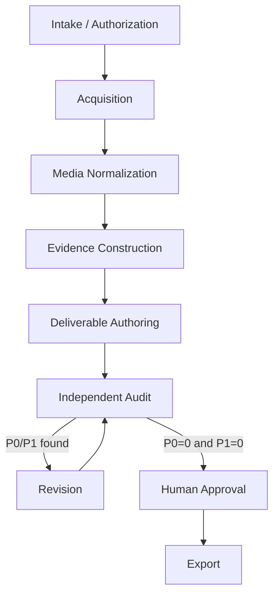

# パイプラインアーキテクチャ

## 1. 設計目標

中核は「動画からレポートを生成すること」ではなく、「動画から検証可能な証拠パッケージを構築し、その証拠から任意の成果物を生成すること」です。

現在、Intake / Authorizationのcore contractと、Acquisitionの`local_file`経路だけが実装済みです。
実動作するstate pathは`CREATED → AUTHORIZED → ACQUIRED`です。その他のsource adapterと後続層は
設計済みですが未実装です。

## 2. 層

### 2.1 Intake / Authorization

入力:

- source URLまたはlocal path
- 利用権限のユーザー宣言
- 外部API送信可否
- 課題文、字数、文体、引用、出力形式
- user notes

出力:

- validated job specification
- authorization record

この層は法的判断を自動化しません。ユーザーの明示確認がないジョブは取得へ進めません。

### 2.2 Acquisition

責務:

- source adapter選択
- source metadata取得
- official download、API、yt-dlp、manual fallback
- raw media保存
- SHA-256計算
- token／cookie redaction

出力:

- immutable raw source
- source manifest
- acquisition log

### 2.3 Media Normalization

責務:

- ffprobe
- analysis proxy作成
- speech audio抽出
- subtitle normalization
- scene／periodic／semantic boundary frame抽出
- contact sheet
- clip生成

出力:

- media manifest
- normalized audio/video
- subtitle segments
- frame index

### 2.4 Evidence Construction

責務:

- 公式字幕優先のtranscript構築
- 不足区間のASR
- raw textとnormalized textの分離
- transcriptとframeの時間整合
- observation、inference、user opinionの区別
- evidence ledger
- local search index

出力:

- transcript segments
- frame observations
- evidence records
- ambiguity ledger

### 2.5 Deliverable Authoring

責務:

- assignment requirement解析
- outline
- report／summary等の成果物
- claim ledger
- requirement map

authorはevidenceにない事実を補完してはいけません。

### 2.6 Independent Audit

責務:

- fresh contextで本文からclaimを再抽出
- source evidenceとの照合
- author claim ledgerとの差分
- requirement compliance
- P0／P1／P2分類

監査者は本文を修正しません。

### 2.7 Revision

責務:

- findingsごとのaccept／reject／defer
- evidenceに基づく局所修正
- resolution ledger
- revised claim ledger

最大自動反復回数を超えた場合はhuman escalationへ進めます。

### 2.8 Human Approval

責務:

- 本人の意見と表現の確認
- 重要な低確度箇所の再生確認
- 提出適否の判断
- approved draft hashの記録

### 2.9 Export

責務:

- approved hash検証
- MarkdownからDOCX／PDF／HTML等へ変換
- final package manifest作成

## 3. Processing lanes

### Deterministic lane

取得、hash、probe、変換、抽出、Schema検証、索引、字数、参照整合性。

### Semantic lane

文字起こし訂正候補、画面理解、証拠化、構成、執筆、監査、修正。

### Human lane

authorization、要件確定、自分の考察、曖昧箇所確認、最終承認、提出。

各laneを一つのopaqueなAI処理へ統合しません。

## 4. Adapter boundaries

初期adapter category:

- `source`: `local_file`のみ実装済み。`direct_http`、`panopto`、`box`、`generic_ytdlp`は未実装
- `transcription`: captions, faster_whisper, optional_cloud
- `vision`: contact_sheet/manual selection, optional model
- `authoring`: report, summary
- `export`: markdown, docx, pdf, html

domain modelは特定backendの引数やレスポンスを直接保持せず、adapter resultへ正規化します。

## 5. Idempotency

各stageは次を入力fingerprintとして持ちます。

- input artifact SHA-256
- normalized configuration
- tool/model identity and version
- stage implementation version

fingerprintが一致し、出力検証が成功する場合は再利用できます。raw sourceの再取得、AI出力の暗黙な再生成は行いません。

## 6. Failure behavior

- 取得失敗を空ファイルで成功扱いしない。
- 文字起こし低確度区間を自然な文で捏造しない。
- frame解析不能を「画面情報なし」と区別する。
- audit findingsを自動的に全acceptしない。
- human approval欠如をAIで補わない。
