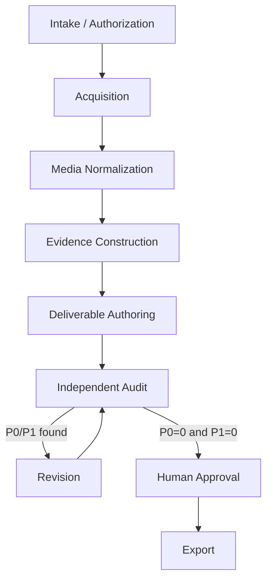

# パイプラインアーキテクチャ

## 1. 設計目標

中核は「動画からレポートを生成すること」ではなく、「動画から検証可能な証拠パッケージを構築し、その証拠から任意の成果物を生成すること」です。

現在、Intake / Authorizationからevidence construction、bounded authoring／independent audit／revision、
human-review packageまで実装済みです。実動作する直線経路は
`CREATED → AUTHORIZED → ACQUIRED → NORMALIZED → TRANSCRIBED → EVIDENCE_READY → DRAFTED → AUDITED → HUMAN_REVIEW_READY`
で、P0／P1が残る経路は最大2回のrevision後に`BLOCKED`です。human approval／exportは未実装です。

## 2. 層

### 2.1 Intake / Authorization

入力:

- source URLまたはlocal path
- 利用権限のユーザー宣言
- 外部API送信可否
- 課題文、字数、文体、引用、出力形式
- user notes

出力:

- validated job specification
- authorization record

この層は法的判断を自動化しません。ユーザーの明示確認がないジョブは取得へ進めません。

### 2.2 Acquisition

責務:

- source adapter選択
- source metadata取得
- official download、API、yt-dlp、manual fallback
- raw media保存
- SHA-256計算
- token／cookie redaction

出力:

- immutable raw source
- source manifest
- acquisition log

### 2.3 Media Normalization

責務:

- ffprobe
- analysis proxy作成
- speech audio抽出
- subtitle normalization
- FFmpeg scene-change／periodic candidate frame抽出とpure-Python perceptual hash重複統合

出力:

- media manifest
- normalized audio/video
- subtitle segments
- frame index

実装はsystem FFmpeg／ffprobeだけを固定argv、`shell=False`、stdin無効、wall-clock timeout、bounded
stdout／stderrで起動します。入力protocolは`file`、demuxerはMVP allowlistへ限定し、playlist／external
reference形式を拒否します。全local inputではconfigの`-max_streams`、`-max_pixels`、`-max_samples`を
probe／decodeより前へ指定します。`-h full`で両toolのgenericな`<int64>` decoder limitを確認し、source
metadataのdimensions、audio sample rate、channelsも別途上限検証します。capability discoveryの両edgeと、pin後の
各subprocess起動直前／終了直後、およびpublish直前に実行fileのSHA-256とstable metadataを再検証します。これにより
persistentまたは偶発的なtool replacementは結果をpublishせず拒否します。same-userがhash境界の間だけ実行fileを
swapして復元するtransient raceはこのMVPのcovered threatではなく、tool installationをtrusted local-admin boundaryに
置きます。PySceneDetectを追加dependencyにせずFFmpegの`select` scene scoreを採用したのは、
同じ検証済みtool identityとprocess境界でcandidate抽出を完結し、lock／fingerprint／CI実行契約を狭く保つためです。
scene検出失敗時はperiodicだけへsilent fallbackせずstageを失敗させます。

`normalized/staging/`はnormalization専用のcross-process lock下だけで使用します。hard crash後のstale
attemptは同lock取得後にdirect childだけを検証して削除し、link、junction、mount point、traversal形状は拒否します。
各output、frame、subtitle、およびaggregate staging bytesを生成中に上限検証し、WebVTT／cue JSONLのfull readは
per-subtitle上限を`stat`で確認した後だけに行います。frame indexの`timestamp_ms`はseek要求値ではなくFFmpeg
`showinfo`で観測した抽出frame PTSであり、要求candidateと選定理由は`candidate_timestamps_ms`に別途保持します。
これらの上限は設定でunboundedに戻せず、aggregateは最大8 GiB、通常の単一outputは最大4 GiB、frameは最大64 MiB、
subtitleの生成／readは最大64 MiBです。

normalizable-text allowlistのembedded subtitle codecは`subrip`／`srt`／`text`／`webvtt`だけです。ASS、SSA、
`mov_text`などstyleまたはcontainer表現を安全にnormalizationできないcodecはunsupportedとして記録します。cue JSONLは
FFmpeg WebVTT transcodeから得るnormalized decoded cue textであり、`raw_text_preserved`は常にfalseです。raw media
bytesはimmutableのままですが、SRT／WebVTTのpresentationやcontrol markupを含むcue textはexact preservationを約束しません。

### 2.4 Evidence Construction

責務:

- 公式字幕優先のtranscript構築
- 不足区間のASR
- raw textとnormalized textの分離
- transcriptとframeの時間整合
- observation、inference、user opinionの区別
- evidence ledger
- local search index

出力:

- transcript segments
- frame observations
- evidence records
- ambiguity ledger

transcriptionはnormalized text subtitleのうちcueが存在するstreamだけを候補とし、明示された言語順、
`official → embedded → sidecar`、default、non-forced、stream indexの順で決定的に1つを選びます。
caption coverageが設定値以上ならASR package／modelを要求しません。不足時だけcoverage gapをprovider-neutral
`AsrBackend`へ渡します。組込みadapterは完全なlocal faster-whisper model directoryだけをoffline／
`local_files_only`でlazy loadし、model名からのdownload、cloud fallback、依存packageの暗黙追加を行いません。
device、compute type、decode option、backend／library／model identityはfingerprintへ含めます。

各segmentはinteger millisecond、連続ID、source artifact／record／backend lineageを保持します。
`raw_text`はcaption adapterまたはASR backendから受け取った文字列、`normalized_text`はNFKC＋空白正規化後の
検索・比較用文字列です。subtitle normalization以前のmarkupやsource bytesを`raw_text`が保存するとは主張しません。
caption confidenceは`not_available`、ASRの`avg_logprob`／`no_speech_probability`等はbackend raw metricとして
保存し、確率校正済みconfidenceへ読み替えません。

`vep evidence prepare`はassignment、順序付きrequirements、exact transcript segment／SourceRef、frame
record／artifact／SourceRef、承認済み外部artifact catalog、未解決ambiguityを固定requestへ束縛します。
`vep evidence import`はprovider-neutral responseのrequest fingerprint、analyzer identity／execution mode／
external API利用、全SourceRefの完全一致、timestamp、interpretation level、review status、未解決ambiguity保持を
検証します。生成されたuser opinion、非直接解釈のvideo fact化、analyzer自身によるaccept／reject、未承認の
external fact sourceを拒否します。検証前responseはcanonicalにせず、private attemptを全上流bundleの再検証後に
最終transition lock内で再度full verifyしてからcontent-addressed公開し、manifestをcommit marker、state
transitionを最後に書きます。支持可能なrecordがないresponseも有効であり、evidenceを捏造せずcanonical
zero-line JSONLとして表現します。metric availabilityはtyped confidenceに保持し、それ自体をambiguityへ昇格
しません。その他の真正なsegment uncertainty flagは未解決ambiguityとして保持します。

SQLite FTS5 indexはcanonical evidenceではなく削除可能なprivate cacheです。`normalized_text`とevidence
`observation`だけを明示`trigram` tokenizerで索引化し、1〜2文字は種類ごと4096件までのparameterized literal
scanを使います。canonical JSON／JSONLからのfile-backed再構築とFTS integrity checkを`EVIDENCE_READY`
gateで証明し、source fingerprint、document fingerprint、normalizer、query／builder version、SQLite capabilityが
一致しないcacheはstale／invalidとして再構築します。DBをstage manifestやstate gateのcanonical artifactへ
追加しません。

### 2.5 Deliverable Authoring

責務:

- assignment requirement解析
- outline
- report／summary等の成果物
- claim ledger
- requirement map

authorはevidenceにない事実を補完してはいけません。

`vep author prepare`はjobに属するfixed selected-evidence bundle、requirements、constraints、Skill snapshotを
immutable requestへ固定します。provider-neutral response importはclaim typeごとのinterpretation境界、evidence／
requirementの相互対応、user opinionの`[要確認]`表現、UTF-8 byte上限を検証し、`v001`をprivate stagingから
exclusive publishします。production importは`active` Skillだけを許可し、現行draft Skillではfail closedします。
request内のSkill snapshotはimmutable lineageとして保持し、完成済み履歴の再検証を現在のregistry内容へ結合しません。
完成済みのauthor／audit／revision importを同一responseで再実行する場合も、保存済みrequestとcanonical responseの
完全一致を先に検証し、現在のSkill content／eval／lifecycleは再適格性判定へ使用しません。
pending production importは、現在のSkillが同じcontent／eval／identityのまま`active`へ昇格した場合だけ許可し、
それ以外のdriftは`SKILL_SNAPSHOT_STALE`で拒否します。

### 2.6 Independent Audit

責務:

- fresh contextで本文からclaimを再抽出
- source evidenceとの照合
- author claim ledgerとの差分
- requirement compliance
- P0／P1／P2分類

監査者は本文を修正しません。

audit requestはtarget draftとfixed evidenceだけをserializationし、author claim ledger、agent run／context、prompt
history、private reasoningを物理的に含めません。auditor contextは過去の全author／reviser／auditor contextと異なる
必要があり、provider／model／context identityはmanifestへ記録します。validated response import後にauthor claimとの
comparison artifactを決定的に生成します。context identityはprovider-neutralな自己申告lineageであり、外部providerの
実行分離を暗号学的に証明するものではありません。
全findingはdraft／audit claim／requirementへ束縛し、P0／P1はexact draft spanを必須とします。evidence-linked
findingは引用したEvidenceRecordのSourceRef unionと完全一致しなければなりません。

### 2.7 Revision

責務:

- findingsごとのaccept／reject／defer
- evidenceに基づく局所修正
- resolution ledger
- revised claim ledger

resolution ledgerはfindingごとのaccept／reject／defer、evidence、old／new diff spanを保持します。`v002`／`v003`
だけを許可し、predecessor、audit、request、response、context historyをfull verifyします。最大2回のrevision後も
P0／P1が残る場合は`BLOCKED`へ進め、`v004`を生成しません。clean auditではcurrent draft、audit findings、
claim comparison、requirements、revision historyを`is_approval: false`のhuman-review packageへ固定します。
ACCEPTのevidenceは対応findingと完全一致し、各insert／replace／delete hunkはそのfindingのexact draft spanへ
位置的に帰属しなければなりません。old sideを持つhunkはhalf-open spanとしてstrict overlapを要求し、
zero-width insertionだけは挿入点がanchor境界上または内部にある場合を許可します。

### 2.8 Human Approval

責務:

- 本人の意見と表現の確認
- 重要な低確度箇所の再生確認
- 提出適否の判断
- approved draft hashの記録

### 2.9 Export

責務:

- approved hash検証
- MarkdownからDOCX／PDF／HTML等へ変換
- final package manifest作成

## 3. Processing lanes

### Deterministic lane

取得、hash、probe、変換、抽出、Schema検証、索引、字数、参照整合性。

### Semantic lane

文字起こし訂正候補、画面理解、証拠化、構成、執筆、監査、修正。

### Human lane

authorization、要件確定、自分の考察、曖昧箇所確認、最終承認、提出。

各laneを一つのopaqueなAI処理へ統合しません。

## 4. Adapter boundaries

初期adapter category:

- `source`: `local_file`、`direct_http`、`panopto`、`box`、`generic_ytdlp`を実装済み
- `transcription`: normalized captions、offline local faster-whisper（不足区間のみ）を実装済み
- `vision`: contact_sheet/manual selection, optional model
- `authoring`: report, summary
- `export`: markdown, docx, pdf, html

domain modelは特定backendの引数やレスポンスを直接保持せず、adapter resultへ正規化します。

## 5. Idempotency

各stageは次を入力fingerprintとして持ちます。

- input artifact SHA-256
- normalized configuration
- tool/model identity and version
- stage implementation version

fingerprintが一致し、出力検証が成功する場合は再利用できます。raw sourceの再取得、AI出力の暗黙な再生成は行いません。
network sourceは有効な`ACQUIRED` bundleをlocal検証して再利用し、通常の再実行でnetworkへ接続しません。
`local_file`は再probeしてcontent changeを検出します。
完全な`NORMALIZED` bundleの再実行は、保存済みtool version／executable SHA-256／capabilityを含むfingerprintと
全artifactをlocal検証し、FFmpeg／ffprobe subprocessを起動せず再利用します。新規処理中はjob lockを保持せず、
snapshot取得と公開直前のstate／raw hash再検証だけをlock下で行います。
`TRANSCRIBED`／`EVIDENCE_READY`／authoring／audit／revision／human-reviewもprimary manifest、stage manifest、
全content artifact、semantic fingerprint、lineageをfull verifyしてから再利用します。semantic validationとprivate
staging中はtransition log lockを保持せず、公開直前の短いlock区間内でstate、authorization、job／fixed bundle、
全履歴artifactのhashとsemantic bindingを再検証し、manifestとtransitionを最後にcommitします。
author／audit／revisionでcontent artifact公開後かつprimary manifest前にprocessが停止した場合は、最後に公開した
AgentRunRecordをdurable markerとして全content／request／response／lineageを再検証し、元のtimestampとfingerprint
から同一manifestを再構築します。human-reviewでは先に公開したbundle自身をdurable markerとし、bundleの`created_at`
からstage／primary manifestを決定的に再構築します。markerより前のpartial outputは同一contentなら再利用し、
不一致ならfail closedします。

## 6. Failure behavior

- 取得失敗を空ファイルで成功扱いしない。
- 文字起こし低確度区間を自然な文で捏造しない。
- frame解析不能を「画面情報なし」と区別する。
- audit findingsを自動的に全acceptしない。
- human approval欠如をAIで補わない。
