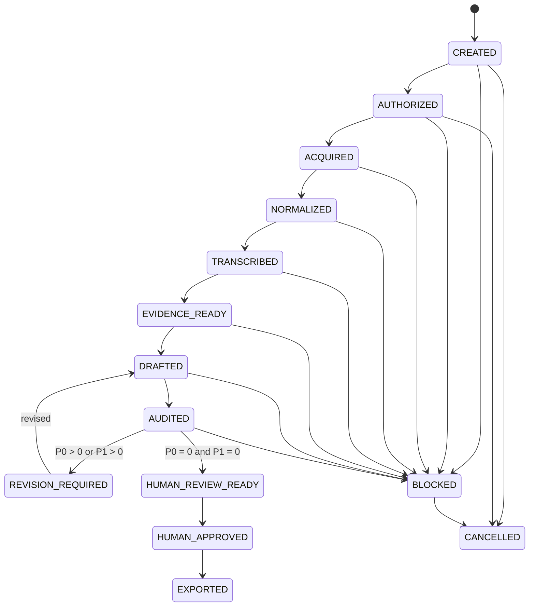

# ジョブ状態機械

## 1. 状態一覧

| State | 意味 |
|---|---|
| `CREATED` | job specificationが作成された |
| `AUTHORIZED` | 利用権限と外部送信条件をユーザーが確認した |
| `ACQUIRED` | raw sourceとsource manifestが検証済み |
| `NORMALIZED` | media manifestと解析用素材が検証済み |
| `TRANSCRIBED` | transcript sourceが生成・検証済み |
| `EVIDENCE_READY` | evidence ledgerとambiguity ledgerが利用可能 |
| `DRAFTED` | draft、claims、requirement mapが生成済み |
| `AUDITED` | 独立監査結果が生成済み |
| `REVISION_REQUIRED` | P0またはP1が存在する |
| `HUMAN_REVIEW_READY` | P0=0、P1=0で人間確認可能 |
| `HUMAN_APPROVED` | draft hashへ人間承認が付与された |
| `EXPORTED` | 承認hashから最終形式を生成した |
| `BLOCKED` | 人間判断、認証、tool、根拠不足等で停止 |
| `FAILED` | stageが失敗し、有効な出力がない |
| `CANCELLED` | ユーザーが処理を中止した |

全stateは`JobState` enumとして実装されています。実行可能な遷移は現在
`CREATED → AUTHORIZED → ACQUIRED`だけです。後続遷移はmodel／policy上の設計契約として存在しても、
CLIから実行できません。

## 2. 遷移

## 3. Gate

### `CREATED → AUTHORIZED`

- sourceが特定されている
- `confirmed_by_user: true`
- local processing可否
- external API可否
- assignment requirementsが最低限存在
- normalized job fingerprintとauthorization recordが対応する
- CLIでは`--confirm`を必須とし、external APIは明示allowしない限りdenyとする

### `AUTHORIZED → ACQUIRED`

- raw sourceが存在
- non-zero size
- content hash
- source manifest
- token／cookieがmanifestから除去済み
- copy後のsize／SHA-256再検証
- authorizationのjob fingerprintがcurrent jobと一致

ここまでが実装済みgateです。以下は未実装stageの設計gateであり、現在のCLIでは実行できません。

### `ACQUIRED → NORMALIZED`

- ffprobe成功
- durationが妥当
- audio/video/subtitleの存在が記録
- 必要な派生成果物のhashが存在

### `NORMALIZED → TRANSCRIBED`

- 公式字幕またはASR resultが存在
- timestampがduration範囲内
- rawとnormalized textが分離
- backend identityが記録

### `TRANSCRIBED → EVIDENCE_READY`

- evidence参照先が存在
- confidenceとinterpretation levelが存在
- unresolved ambiguityが台帳化
- indexが再構築可能

### `EVIDENCE_READY → DRAFTED`

- assignment requirement map作成可能
- selected evidenceが存在
- user opinionが必要な箇所を捏造していない
- draftとclaim ledgerが対応

### `DRAFTED → AUDITED`

- fresh-context auditor
- audit claims
- findings
- severity
- source refs
- author claimsとの差分

### `AUDITED → HUMAN_REVIEW_READY`

- `P0 = 0`
- `P1 = 0`
- unresolved `[要確認]` の扱いが明示
- length／format等のdeterministic gate成功

### `HUMAN_REVIEW_READY → HUMAN_APPROVED`

- 人間が対象draftを確認
- approval record
- draft SHA-256
- 承認日時

### `HUMAN_APPROVED → EXPORTED`

- approval hashとcurrent draft hashが一致
- export成功
- final manifest作成
- finalに禁止markerがない

## 4. Revision limit

自動revisionは既定で最大2回とします。上限後もP0/P1が残る場合、`BLOCKED`へ遷移し、人間確認を要求します。

## 5. 再実行

同じstateへの再実行は、入力fingerprintが変わらない限り既存出力を再利用できます。fingerprintが変化した場合、依存する後続stateをstaleとして扱い、承認を無効化します。

## 6. 失敗とblockedの区別

- `FAILED`: tool error、破損出力、Schema違反等
- `BLOCKED`: authorization未確認、Cookie期限切れ、ユーザー意見不足、曖昧発話等

blockedをretry loopで自動的に解消したことにしません。
