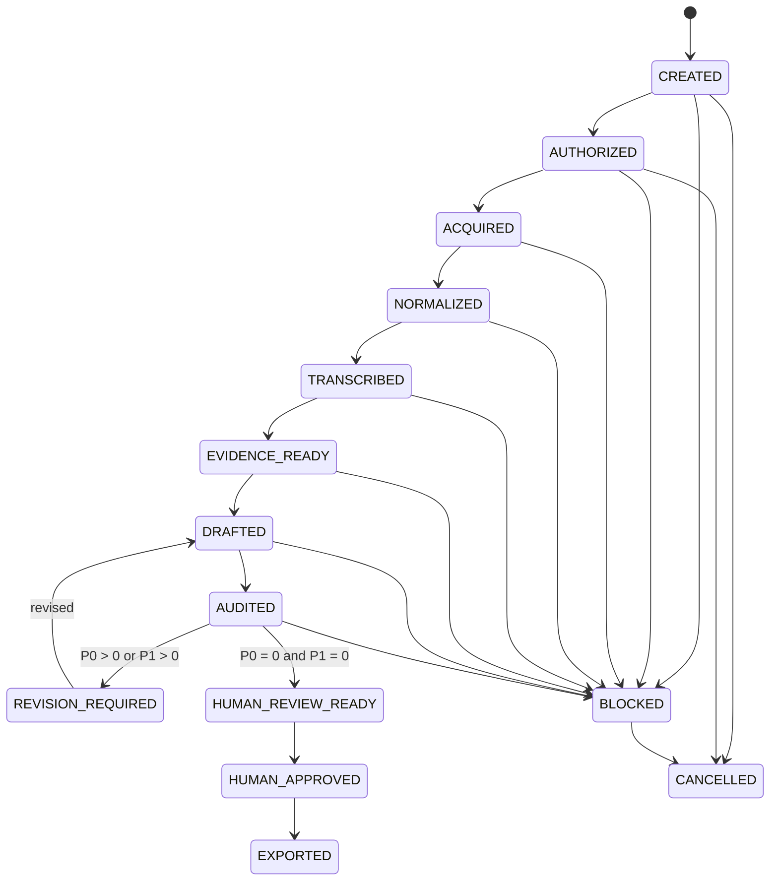

# ジョブ状態機械

## 1. 状態一覧

| State | 意味 |
|---|---|
| `CREATED` | job specificationが作成された |
| `AUTHORIZED` | 利用権限と外部送信条件をユーザーが確認した |
| `ACQUIRED` | raw sourceとsource manifestが検証済み |
| `NORMALIZED` | media manifestと解析用素材が検証済み |
| `TRANSCRIBED` | transcript sourceが生成・検証済み |
| `EVIDENCE_READY` | evidence ledgerとambiguity ledgerが利用可能 |
| `DRAFTED` | draft、claims、requirement mapが生成済み |
| `AUDITED` | 独立監査結果が生成済み |
| `REVISION_REQUIRED` | P0またはP1が存在する |
| `HUMAN_REVIEW_READY` | P0=0、P1=0で人間確認可能 |
| `HUMAN_APPROVED` | draft hashへ人間承認が付与された |
| `EXPORTED` | 承認hashから最終形式を生成した |
| `BLOCKED` | 人間判断、認証、tool、根拠不足等で停止 |
| `FAILED` | stageが失敗し、有効な出力がない |
| `CANCELLED` | ユーザーが処理を中止した |

全stateは`JobState` enumとして実装されています。実行可能な直線経路は現在
`CREATED → AUTHORIZED → ACQUIRED → NORMALIZED → TRANSCRIBED → EVIDENCE_READY → DRAFTED → AUDITED → HUMAN_REVIEW_READY → HUMAN_APPROVED → EXPORTED`
です。P0／P1がある場合は`AUDITED → REVISION_REQUIRED → DRAFTED`を最大2回反復し、上限後も
material findingが残れば`AUDITED → BLOCKED`へ進みます。

## 2. 遷移

## 3. Gate

### `CREATED → AUTHORIZED`

- sourceが特定されている
- `confirmed_by_user: true`
- local processing可否
- external API可否
- assignment requirements fieldが構造上有効で、`job init`時に確定している
  - 追加要件がないassignmentでは空配列を許可する
  - 指定された要件は空白以外かつ512文字以内で、順序をfingerprintへ含める
- normalized job fingerprintとauthorization recordが対応する
- CLIでは`--confirm`を必須とし、external APIは明示allowしない限りdenyとする

### `AUTHORIZED → ACQUIRED`

- raw sourceが存在
- non-zero size
- content hash
- source manifest
- token／cookieがmanifestから除去済み
- copy後のsize／SHA-256再検証
- authorizationのjob fingerprintがcurrent jobと一致

### `ACQUIRED → NORMALIZED`

- safe demuxer／file protocol限定でdecoder slot上限を入力前に指定したffprobeが成功し、duration、dimensions、audio rate／channels、stream countが上限内
- analysis proxyと、audio streamがある場合のmono固定rate lossless speech audioを出力再probe済み
- normalizable-text allowlistのtext subtitleだけはWebVTT由来のnormalized decoded cue JSONLを出力し、raw-text preservationを主張せず、ASS／SSA／`mov_text`、bitmap／unknown subtitleはunsupported warningとして記録
- periodic／scene-changeの要求candidateと実際にFFmpegが観測したframe PTSがduration範囲内で、pHash重複統合理由を保持
- raw artifactが不変で、全派生成果物のsize／SHA-256とnormalization fingerprintが一致

### `NORMALIZED → TRANSCRIBED`

- normalized subtitleを言語、`official → embedded → sidecar`、default、non-forced、stream indexで決定的に選択
- caption coverageが十分ならsubtitleだけで成功し、不足時だけspeech audioと明示local ASR backendを使用
- segment IDがunique／contiguousで、integer millisecond timestampがduration範囲内
- gap／overlap policyとcanonical intervalがmanifestへ記録
- adapter出力の`raw_text`とNFKC＋空白正規化後の`normalized_text`を分離
- source artifact／record、subtitle provenance、backend identity、config、implementation versionがfingerprintとlineageへ記録
- canonical transcript JSONL、transcript manifest、stage manifestをfull verifyし、transitionを最後にappend

### `TRANSCRIBED → EVIDENCE_READY`

- fixed requestにassignment／ordered requirements、exact transcript／frame catalog、承認済み外部artifact catalogが存在
- provider-neutral responseがrequest fingerprintとanalyzer metadataへ束縛され、external API利用が認可済み
- 全SourceRefがcatalogのID／timestamp／content hashと完全一致
- confidenceとcanonical interpretation levelが存在し、非直接解釈をvideo factとして主張しない
- generated user opinionとanalyzerによるself-approvalが存在しない
- unresolved ambiguityが欠落／解決済みへ改変されず台帳化
- 支持可能なevidenceが0件でもrecordを捏造せず、canonical zero-line JSONLとして表現可能
- validated response、evidence JSONL、ambiguity ledger、manifest／stage manifestがfull verify可能
- canonical JSON／JSONLからprivate FTS5 trigram cacheを再構築しintegrity checkできる
- final transition lock内の全上流bundle再検証後、primary manifestをcommit marker、transitionを最後にappend

### `EVIDENCE_READY → DRAFTED`

- jobに属するfixed evidence bundleにselected evidenceが1件以上存在
- provider-neutral author request／responseがexact requirements、evidence、Skill snapshotへ束縛される
- video／visual／inference／external fact claimが許可されたinterpretation levelとevidenceへ相互に対応
- user opinionは生成せず、必要箇所を`[要確認]`として残す
- immutable `v001` draft、claim ledger、requirement map、response、manifest／stage manifestをfull verify可能
- repository-local Skillが`active`でないproduction importを拒否する
- effective length constraintがある場合、canonical character countがrange内である
- range外attemptはsemantic revisionと別の有限length adjustment ledgerへ記録する

### `DRAFTED → AUDITED`

- audit requestの物理serializationにauthor claim／run／context／prompt history／private reasoningを含めない
- target draftとfixed evidenceに束縛したfresh context auditorで、過去author／reviser／auditor contextを再利用しない
- audit claims、P0／P1／P2 findings、exact evidence／SourceRefを検証する
- 全findingをdraft／audit claim／requirementへ束縛し、P0／P1はexact draft spanを必須とする
- validated import後にauthor claimとの差分artifactを決定的に生成する
- P0／P1があれば`REVISION_REQUIRED`、なければ`HUMAN_REVIEW_READY`へ進める

### `AUDITED → REVISION_REQUIRED → DRAFTED`

- findingごとの`accept`／`reject`／`defer`とevidence根拠をresolution ledgerへ記録
- accepted findingのinsert／replace／delete hunkをold／new spanとして決定的diffと完全一致させる
- accepted resolutionのevidenceをfindingと完全一致させ、各hunkをそのfindingのdraft spanへ位置的に帰属させる
- `v002`／`v003`をimmutableに公開し、predecessor、audit、request、response、全fresh contextをlineageへ固定
- revision countは最大2回で、上限後もP0／P1があれば`AUDITED → BLOCKED`とし`v004`を作らない
- revised draftへ同じlength gateを適用し、失敗したlength attemptはsemantic revision countを増やさない

### `AUDITED → HUMAN_REVIEW_READY`

- `P0 = 0`
- `P1 = 0`
- unresolved `[要確認]`と`confirmation_spans`の扱いが明示され、人間確認packageへ可視化される
  - これらは`HUMAN_REVIEW_READY`まで残り得るが、approval authorizationではない
- effective min／maxを含むcanonical length checkとformat等のdeterministic gate成功
- current draft、audit findings、claim comparison、requirement map、revision history、approval target SHA-256を
  human-review bundleへ固定
- bundleは`is_approval: false`であり、人間承認recordを生成しない

### `HUMAN_REVIEW_READY → HUMAN_APPROVED`

- 人間がhuman-review packageと対象draftを確認し、target SHA、reviewer identity、basis、`--confirm`をCLIへ明示
- current draft、clean audit、fixed evidence、human-review bundle、approval target SHAをfull verify
- full verify済みhuman-review bundleの`confirmation_spans`が空であり、full verify済みdraft bytesにliteral `[要確認]`がない
  - いずれかが残れば`APPROVAL_CONFIRMATION_UNRESOLVED`として停止し、approval ledger／manifest／transitionを生成しない
  - markerで停止したjobは`HUMAN_REVIEW_READY`に留め、v1はdraftをmutateしない。clean contentは別途有効なworkflowまたは新しいjobで作成し、approval／export中にmarkerを削除・置換しない
  - genericなapproval `unresolved_notes`や`unresolved_ambiguity_ids`を、このmarker解消gateと同一視しない
- self-hashとprevious hashを持つapproval recordをprivate append-only JSONLへ1行だけ追記
- v1のreviewer identityはCLIでassertされたlineageであり、暗号学的本人確認ではない
- approval record、stage／primary manifestを公開してからtransitionを最後にappend
- record公開後の停止は同じrecordから決定的に復旧し、異なるintentの再実行は拒否

### `HUMAN_APPROVED → EXPORTED`

- approval record／manifest、human-review bundle、audit、current draftを再検証し、approval SHAとdraft SHAを一致させる
- approved draft bytesとfinal candidate bytesを再検証し、literal `[要確認]`を含むfinalを拒否する
  - markerを削除・置換して通過させず、cleanなfinal bytesはapproved draft bytesと完全一致する
- `job.output.format = markdown`だけを実装し、approved draft bytesをdecode／再encode／改行変換せずcopy
- private content-addressed pathへ`final.md`、package manifest、stage／primary manifestの順に公開
- export artifactのbytes、size、SHA-256をapproved draftと完全一致させ、transitionを最後にappend
- package／primary manifest公開後の停止は同一artifactから決定的に復旧
- unsupported format、stale approval、tamperはfail closed

## 4. Revision limit

自動revisionは既定で最大2回とします。上限後もP0/P1が残る場合、`BLOCKED`へ遷移し、人間確認を要求します。

## 5. 再実行

同じstateへの再実行は、入力fingerprintが変わらない限り既存出力を再利用できます。fingerprintが変化した場合、
依存する後続stateをstaleとして扱い、承認を無効化します。v1はtransition logを逆向きに変更せず、stored stateが
`HUMAN_APPROVED`でもapproval bindingが壊れていれば`APPROVAL_STALE`としてexportを拒否します。有効な別contentは
新しいjobで承認します。

`BLOCKED` parentからのrecoveryは別child jobを作り、source／primary／supporting identityが一致する場合だけ
acquisition、normalization、raw transcript、supporting artifactを再利用します。child assignment／outputは変更可能で、
parent／child assignment fingerprintをmanifestへ記録します。evidence、draft、audit、revision、human-review、approval、
exportはコピーせず、childを`TRANSCRIBED`から再開します。

## 6. 失敗とblockedの区別

- `FAILED`: tool error、破損出力、Schema違反等
- `BLOCKED`: authorization未確認、Cookie期限切れ、ユーザー意見不足、曖昧発話等

blockedをretry loopで自動的に解消したことにしません。
