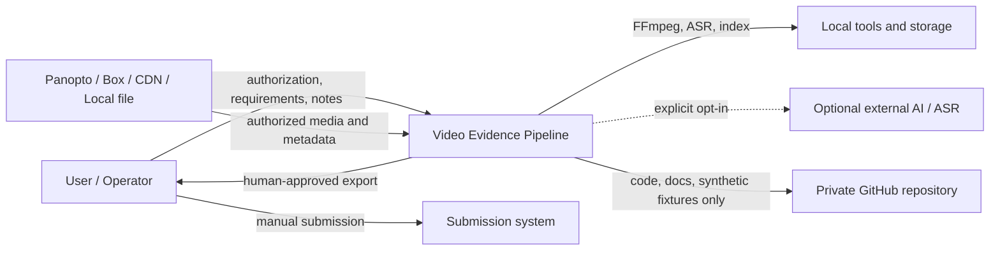

# システムコンテキスト

## 1. 目的

Video Evidence Pipelineが扱う主体、外部システム、責務境界を定義します。

## 2. 利用者

### Primary user

- 動画の利用権限と課題要件を提供する。
- 自分の意見、視聴メモ、提出条件を提供する。
- AIが解決できない曖昧箇所を確認する。
- 最終成果物を確認し、承認する。

### Repository operator

初期段階ではprimary userと同一です。

- ローカル実行環境を管理する。
- Cookie、API token、FFmpeg、GPU等を管理する。
- 取得元ごとの利用条件に従う。
- GitHub上のIssue、PR、releaseを管理する。

### AI agents

- evidence builder
- deliverable author
- independent auditor
- reviser
- human-review preparer

AIは利用権限の付与者、最終承認者、提出主体にはなりません。

## 3. 外部システム

| 外部システム | 用途 | 初期方針 |
|---|---|---|
| Panopto | 講義動画、字幕 | 公式DL優先、認証済み取得はadapter化 |
| Box Enterprise | 動画／資料 | 公式APIまたは手動取得 |
| Generic CDN / HTTP | MP4、HLS | direct HTTPまたはyt-dlp |
| Local filesystem | 手動取得済み入力 | 正式なfallback |
| FFmpeg / ffprobe | probe、変換、抽出 | 必須外部tool |
| Local ASR | 文字起こし | 標準経路 |
| Optional cloud AI / ASR | 意味処理、照合 | 明示許可時のみ |
| GitHub | code、docs、Schema、synthetic fixture | 実データは保存しない |

## 4. System boundary

システム内:

- job設定とauthorization declaration
- source adapter
- media normalization
- transcript／frame／evidence構築
- local index
- authoring bundle
- audit bundle
- revision ledger
- human approval record
- export adapter

システム外:

- 動画配信元の権限管理
- 学校・組織の提出システム
- ブラウザ認証そのもの
- 成績評価
- ユーザー本人の最終判断
- 外部サービスの利用規約判断

## 5. Context diagram

## 6. 成功条件

- 主要な生成主張を動画内証拠または明示された外部根拠へ追跡できる。
- 不明箇所が推測で埋められず、確認対象として残る。
- authorとauditorの責務が分離される。
- 人間承認前の成果物がfinalとして扱われない。
- 実メディアと認証情報がGitHubへ流出しない。
