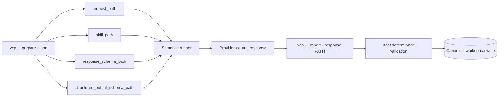

# AI exchange operations

この文書は、VEPとsemantic AI runnerの境界を定義します。AIは固定されたrequestを読み、選択されたSkillとresponse schemaに従うresponseを返します。canonical workspaceへのwrite、state transition、human approvalはdeterministic VEP executorだけが行います。

この文書はproduction Skillのruntime dependencyではありません。production Skillは自身の`SKILL.md`、必要なreference、eval、response contractをself-containedに保持し、ここに書かれた説明の読み込みを前提にしてはいけません。

## Exchange envelope

| 部分 | 役割 | 保存・検証境界 |
| --- | --- | --- |
| `request_path` | assignment、evidence、source refs、ambiguity、要求された出力条件を固定した入力 | VEPがcanonical fingerprintを計算し、対象jobとbindする |
| `skill_path` | stageに束ねられたrepository-local Skillのsnapshotを示す入力 | fuzzy matchingをせず、productionではactiveかつ許可済みのSkillだけを使う |
| `response_schema_path` | stageごとのcanonical response JSON Schemaを示す入力 | VEP import前のstrict validationに使い、未知fieldやfixture形状を受け入れない |
| `structured_output_schema_path` | Structured Outputs runner向けに、全object propertyをrequired化した厳格な生成用schema | private job workspaceへ決定論的に生成する。canonical import schemaや受理条件は変更しない |
| `response` | runnerが作ったprovider-neutralな提案 | response pathは外部private pathでよいが、検証済みbytesだけをcanonical artifactへ公開する |

`prepare --json`の出力をそのままrunnerへのhandoffに使ってください。`request_path`、`skill_path`、`response_schema_path`を推測したり、別jobのrequestと混ぜたりしません。OpenAI/Codexなど、全object propertyの`required`列挙を要求するStructured Outputs runnerでは`structured_output_schema_path`を生成制約に使います。生成後のresponseは従来どおりcanonical `response_schema_path`相当のVEP validatorでimport時に再検証されます。各semantic stageは、対応するSkill snapshotを同じexchangeへ束ねます。

## Prepare → run → import



### Transcript refinement

```bash
uv run vep refine prepare WORKSPACE --json
uv run vep refine import WORKSPACE --response /private/path/refinement-response.json
```

refinement requestはraw transcriptと利用可能なnon-transcript supporting refsを固定します。mechanical cleanupとsemantic correctionを分け、semantic correctionはsupporting evidenceがある1 segmentだけに限定します。固有名詞・数値・専門用語を推測せず、支持できない訂正はambiguityとして保持し、propositionをmergeしません。

### Evidence

```bash
uv run vep evidence prepare WORKSPACE --json
uv run vep evidence import WORKSPACE --response /private/path/evidence-response.json
```

Evidence requestにはassignment、ordered requirements、exact transcript refs、frame refs、supporting-input refs、unresolved ambiguityを固定します。responseの1 recordは1 atomic propositionであり、離れた発言を1つのrelationへ結合しません。source ref、timestamp、artifact hash、interpretation level、ambiguity statusをstrictに検証します。

### Authoring

```bash
uv run vep author prepare WORKSPACE --skill draft-video-summary --json
uv run vep author import WORKSPACE --response /private/path/author-response.json
```

author runnerには`request_path`、`skill_path`、`response_schema_path`の3つを同じexchangeとして渡します。responseはrequirement map、claim／evidence binding、draft本文を含み、assignmentのcharacter length gateをVEP counterで通過しなければ公開されません。AIに文字数を自己申告させて合格扱いにはしません。

### Independent audit

```bash
uv run vep audit prepare WORKSPACE --skill independent-content-audit --json
uv run vep audit import WORKSPACE --response /private/path/audit-response.json
```

auditはauthorとは異なるfresh contextで行います。audit prepareはauthorのprompt history、private reasoning、claim ledgerを正解として渡さず、対象draftとfixed evidenceだけを固定します。audit responseのfindingはtarget draft span、evidence、requirement、severityへ結び付きます。

P0／P1が0件なら`HUMAN_REVIEW_READY`、1件以上なら`REVISION_REQUIRED`です。監査がhuman approvalを生成したり、findingを削除してreadyへ進めたりすることはありません。

### Revision

```bash
uv run vep revision prepare WORKSPACE --skill revise-from-audit --json
uv run vep revision import WORKSPACE --response /private/path/revision-response.json
```

revision responseは既存findingへのresolutionだけを扱います。対象外の全面rewrite、evidence範囲外の新しい断定、findingに対応しないdiffは拒否されます。許可されたsemantic revisionは`v002`、`v003`までで、なおP0／P1が残れば`BLOCKED`です。

## `vep job guide`

```bash
uv run vep job guide WORKSPACE
```

`job guide`はread-onlyのoperator guidanceです。少なくとも次を現在stateから導きます。

- `job_id`とstored/effective state
- next operationとその理由
- 必要な`request_path`、`skill_path`、`response_schema_path`
- network、FFmpeg、ASR、external API、workspace writeのside-effect分類

guideはrequest、artifact、transition、manifestを新規生成しません。stateが不明、上流artifactが不整合、current Skillがdraft／invalidの場合は、成功経路を推測せず停止理由を示します。

pending requestだけはcurrent production import契約へread-only分類します。`current`なら通常のprepare／importを案内し、Skill bindingがない`legacy-unbound`または古いsnapshotの`stale-skill`なら`migration-required`とします。親requestを上書きせず、verified transcriptからchildをrecoverしてcurrent Skill-bound requestをfreshに作ります。recovery guidanceのnetwork acquisition、normalization、FFmpeg、ASR、model provisionはすべてfalseです。completed artifactは保存済みfrozen requestで検証し、current Skill driftをmigration理由にしません。

## Import invariants

deterministic executorは、stageごとに少なくとも次を検証します。

- request自己fingerprintは通常のprepare／import／publication境界で常に再計算し、job／upstream artifactとのbindingも検証（large artifactのbyte再hashはdeep validation）
- response schemaのstrict validation、UTF-8、サイズ上限、未知field拒否
- Skill snapshotのID、content、eval、実行mode、許可されたlifecycle
- SourceRefのID、timestamp、artifact hash、supporting-input identity
- ambiguityの保持と、sourceにないowner／deadline／numberの非推測
- requirement coverageとoutput format
- canonical character counterによるlength range
- author／auditor／reviser contextの独立性
- state transition、atomic publication、immutable upstream artifact

検証に失敗したresponseはcanonical workspaceへコピーせず、structured errorで停止します。fixture、mock、synthetic responseをproduction importへ流用しません。

## Authorization and privacy

- 外部APIを使うresponseはjob authorizationの`allow_external_api`が必要です。
- network acquisitionはsource取得の明示許可が必要で、credential valueはCLI引数やartifactへ保存しません。
- response、transcript、evidence、private indexはrepository外のjob workspaceに置きます。
- raw sourceをsemantic responseで上書きしません。source identityが変わった場合は新しいjobまたは明示recoveryが必要です。
- `HUMAN_APPROVED`へ進める操作はAI／Skillから到達できず、人間がtarget SHA、reviewer、basis、`--confirm`を入力します。

## Stop conditions

次の状態では、runnerの再試行で契約を弱めず、原因を修正してから同じrequestへ戻ります。

- pending requestの`SEMANTIC_REQUEST_MIGRATION_REQUIRED`（親をpatchせずtranscript-boundary recovery）
- current Skillの`SKILL_SNAPSHOT_STALE`、`DRAFT_SKILL_FORBIDDEN`
- `FIXTURE_ANALYZER_FORBIDDEN`、`EXTERNAL_API_NOT_AUTHORIZED`
- request／response fingerprint mismatch、unknown field、invalid SourceRef
- `ARTIFACT_INTEGRITY_FAILED`、`APPROVAL_STALE`、immutable sourceの変更
- P0／P1 finding、length adjustment budget exhaustion、revision limit exhaustion

これらは「AIがそれらしく回答した」ことでは解消しません。未実行、証拠不足、権限不足は`Not Run`または`BLOCKED`として残します。

## 関連文書

- [README](../../README.md): 初見向けの全体像と最短経路
- [Getting started](../getting-started.md): transcript／mediaの実行例
- [Semantic quality](../concepts/semantic-quality.md): research-backed selection方針
- [Trust boundaries](../architecture/trust-boundaries.md): security boundary
- [CLI and local workspace operations](cli-and-local-workspace.md): state／workspace／recovery
